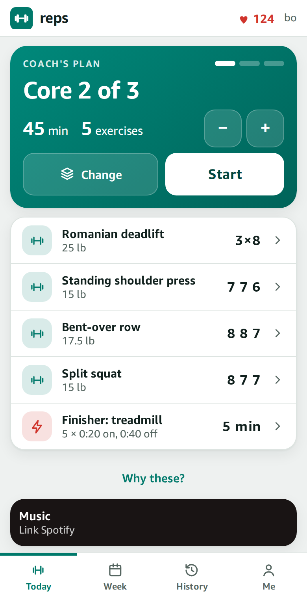
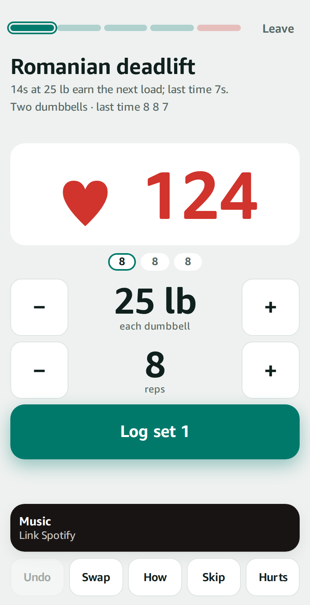
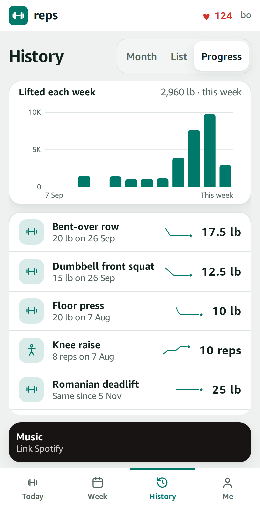

# reps

A home workout coach for two people, running on a small server at home. It decides the next
session from your equipment, time, goals and history, walks you through it on a phone, and adjusts
the plan from what you actually did.

| Today | During a set | Progress |
|---|---|---|
|  |  |  |

The pictures use made-up data.

## What it does

- **Plans strength and cardio** across the week: movement patterns, sets and reps, warm-up and
  cool-down, fitted to the minutes you have. Every prescription comes with its reason.
- **Progresses by rules, not vibes**: double progression over the dumbbells' real dial settings.
  It knows when a weight jump is too big to make at once and bridges it, eases off after a layoff,
  and backs down after a miss.
- **Built or described workouts**: drag blocks together, or type "25 min cardio using the rower
  and treadmill, then 20 min upper body". Simple phrases are parsed locally. The rest goes to
  Claude, which may choose only from allowed blocks, with everything it returns checked again.
- **Guided or simple**: one set at a time with timers, or the whole workout as a list to tick off.
- **Intervals and timers** that survive a locked phone, pauses, and a lost connection.
- **Heart rate** over Bluetooth LE, and **Spotify** playlists that change with the stage.
- **History and progress**, full JSON export, and nightly encrypted copies off the server.

## How it is made

- **Python standard library only** for the app: `http.server`, SQLite (WAL, numbered migrations),
  server-drawn HTML. JavaScript is plain ES modules with no build step. Charts are server-drawn SVG.
- **The coach is pure functions** (`src/reps/coach/`): no database, clock or network. A session is
  worked out by replaying history, so there is no hidden state to corrupt.
- **Separate processes by trust**: the Bluetooth receiver, the Claude client and the copier to
  cloud storage each have their own user, dependencies and systemd sandbox. The one that talks to
  Claude can't read the database; the one that uploads sees only encrypted files.
- **Offline first where it matters**: logged sets wait in an outbox on the phone, and are sent once
  each however often they are retried. One that is refused is set aside, never blocking the rest.

### Testing

About 650 tests. The parts that could hurt someone get the most:

- **Simulated lifters** train for a year each (steady, stalling, erratic, returning, always tired).
  Invariants must hold throughout: every load can be dialled, equipment limits are never passed,
  nothing rises that wasn't earned.
- **Every screen is driven in Chromium** (`tools/check_screens.py`), light and dark, at phone heights
  from 553 to 900 px. Nothing may overlap or be cut off, and the page may not scroll.

### Security and privacy

- TLS only, a strict Content-Security-Policy (no inline script or style), `__Host-` cookies, hashed
  session tokens, lockout, and same-origin checks on every change.
- Units run with `ProtectSystem=strict`, empty capability sets and address restrictions, so the
  ones that reach the internet can't reach the rest of the house.
- Each person sees only their own data. Claude is sent the typed words, the allowed exercises and
  coarse preferences: never body weight, heart rate, injuries, history or names.

## Try it

```sh
uv run pytest -q
uv run ruff check .
```

To run it, copy `dev.toml.example` and make a shadow file for a password
(`openssl passwd -6` prints the hash to put in it):

```sh
mkdir -p /tmp/reps-dev
echo "al:$(openssl passwd -6):20000:0:99999:7:::" > /tmp/reps-dev/shadow
REPS_CONFIG=dev.toml.example uv run reps serve     # http://localhost:8091
```

## Caveats

This is a published copy of a private project, made for reading. Names, addresses and hosts are
replaced, and the parts specific to the house (deployment, certificates, the full specification)
are left out. The equipment is one household's, including a particular pair of adjustable
dumbbells. It isn't medical or coaching advice.

## How it was built

Designed and directed by me, with the code written with
[Claude Code](https://claude.com/claude-code): I set the product, the rules the coach must keep,
the constraints (standard library only, no scrolling page, privacy boundaries), and decided on every
change by using it in real workouts.

## Licence

[MIT](LICENSE).
